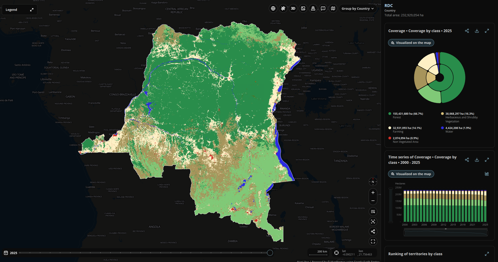

# Earth Observation & Global South Research Datasets

This repository contains a curated collection of datasets and their respective download scripts used for our research, with a strong focus on settlement development, population mapping, and Earth Observation in the Global South.

<hr>

So far, the newsletter consists of a summary of a ***Google Scholar Alert*** with various tags. The tags can be edited by anyone that receives the newsletter.

If you want to receive the newsletter, please visit [https://www.listserv.dfn.de/eo-global-south](https://www.listserv.dfn.de/eo-global-south).

Current tags of the scholar notifications:
```text
global south, informal, settlement, urban, development, sustainable, biomass, mining, 
```

A copy of the last newsletter is accessible [here](letters/current.html).


# Featured 
<hr>
🗺️ News: MapBiomas DRC Is Now Available!

<p><strong>
    The first MapBiomas land-cover and land-use collection for the Democratic Republic of the Congo is here!
</strong></p>

Released in August 2026, MapBiomas DRC Collection 1 provides annual land-cover and land-use maps covering 2000–2025, opening new opportunities to analyse land-use dynamics, forest cover, and landscape change across the country.

<p>
<a href="https://plataforma.mapbiomas.org/coverage/coverage_coverage-wv8p91?t%5BregionKey%5D=democratic-republic-of-congo&tl%5Byear%5D=2025">
    
</a>
<br/>
<em>MapBiomas DRC — Land cover and land use, 2025. Click the map to explore the interactive platform.</em>
</p>

✨ Highlights
- 25 years of mapping: Annual maps spanning 2000–2025.
- Nine thematic classes: A national classification of land cover and land use.
- Open data: Publicly accessible data for research, monitoring, and environmental analysis.
- African expansion: The first MapBiomas initiative on the African continent.
<hr>

Source: MapBiomas Democratic Republic of the Congo. Please consult the official documentation for data access, methodology, and citation requirements.

# Frequently used Datasets and Download helpers

| Dataset                                       |                                                                                                                  | Link                                                                                   | Script to download                                              | 
|-----------------------------------------------|------------------------------------------------------------------------------------------------------------------|----------------------------------------------------------------------------------------|-----------------------------------------------------------------| 
|                                               |                                                                                                                  |                                                                                        |                                                                 |
|                                               |                                                                                                                  |                                                                                        |                                                                 |
| **SETTLEMENT DEVELOPMENT**                    |                                                                                                                  |                                                                                        |                                                                 | 
| World Settlement Footprint (WSF) 2015         | <span style="background-color:rgba(2, 176, 62, 0.3); color:#1dde66; padding:4px 10px; border-radius:12px;">Trusted</span> | [EOC Geoservice](https://geoservice.dlr.de/web/maps/eoc:wsf2015)                       | [download_wsf2015.py](scripts/download_wsf2015.py)              | 
| World Settlement Footprint (WSF) 2019         | <span style="background-color:rgba(2, 176, 62, 0.3); color:#1dde66; padding:4px 10px; border-radius:12px;">Trusted</span>       | [EOC Geoservice](https://geoservice.dlr.de/web/maps/eoc:wsf2019)                       | [download_wsf2019.py](scripts/download_wsf2019.py)              | 
| WSF Evolution (1985-2015)                     | <span style="background-color:rgba(2, 176, 62, 0.3); color:#1dde66; padding:4px 10px; border-radius:12px;">Trusted</span>       | [EOC Geoservice](https://geoservice.dlr.de/web/maps/eoc:wsf_evolution)                 | [download_wsf_evolution.py](scripts/download_wsf_evolution.py)  | 
| WSF 3D (Building Volume/Height)               | <span style="background-color:rgba(2, 176, 62, 0.3); color:#1dde66; padding:4px 10px; border-radius:12px;">Trusted</span>       | [EOC Geoservice](https://geoservice.dlr.de/web/maps/eoc:wsf3d)                         | [download_wsf3d.py](scripts/download_wsf3d.py)                  | 
| Global Human Settlement Layer (GHSL) Built-up | <span style="background-color:rgba(2, 176, 62, 0.3); color:#1dde66; padding:4px 10px; border-radius:12px;">Trusted</span>       | [JRC GHSL](https://ghsl.jrc.ec.europa.eu/ghs_bu.php)                                   | [download_ghs_built.sh](scripts/download_ghs_built.sh)          | 
| GHS-SMOD (Settlement Model)                   | <span style="background-color:rgba(2, 176, 62, 0.3); color:#1dde66; padding:4px 10px; border-radius:12px;">Trusted</span>       | [JRC GHSL](https://ghsl.jrc.ec.europa.eu/ghs_smod.php)                                 | [download_ghs_smod.sh](scripts/download_ghs_smod.sh)            | 
|                                               |                                                                                                                  |                                                                                       |                                                                 |
|                                               |                                                                                                                  |                                                                                       |                                                                 |
| **EMBEDDING SPACES & FOUNDATION MODELS**      |                                                                                                                  |                                                                                       |                                                                 | 
| AlphaEarth Embeddings                         | <span style="background-color:rgba(2, 176, 62, 0.3); color:#1dde66; padding:4px 10px; border-radius:12px;">Trusted</span>       |*Internal/Requires Access*                                                             | [fetch_alphaearth_embeds.py](scripts/fetch_alphaearth_embeds.py) | 
| Tessera Embeddings                            | <span style="background-color:rgba(2, 176, 62, 0.3); color:#1dde66; padding:4px 10px; border-radius:12px;">Trusted</span>       |*Internal/Requires Access*                                                             | [fetch_tessera_embeds.py](scripts/fetch_tessera_embeds.py)      | 
| Satlas (Super-Resolution/Embeddings)          | <span style="background-color:rgba(2, 176, 62, 0.3); color:#1dde66; padding:4px 10px; border-radius:12px;">Trusted</span>       | [Satlas AllenAI](https://satlas.allenai.org/)                                          | [download_satlas.py](scripts/download_satlas.py)                | 
| Prithvi (NASA/IBM Geospatial FM)              | <span style="background-color:rgba(2, 176, 62, 0.3); color:#1dde66; padding:4px 10px; border-radius:12px;">Trusted</span>       | [Hugging Face](https://huggingface.co/ibm-nasa-geospatial)                             | [download_prithvi.py](scripts/download_prithvi.py)              | 
|                                               |                                                                                                                  |                                                                                        |                                                                 |
|                                               |                                                                                                                  |                                                                                        |                                                                 |
| **LAND COVER CLASSIFICATIONS**                |                                                                                                                  |                                                                                        |                                                                 | 
| ESA WorldCover 10m                            | <span style="background-color:rgba(2, 176, 62, 0.3); color:#1dde66; padding:4px 10px; border-radius:12px;">Trusted</span>      | [ESA WorldCover](https://esa-worldcover.org/en)                                        | [download_worldcover.py](scripts/download_worldcover.py)        | 
| Google Dynamic World                          | <span style="background-color:rgba(2, 176, 62, 0.3); color:#1dde66; padding:4px 10px; border-radius:12px;">Trusted</span>      | [Dynamic World](https://dynamicworld.app/)                                             | [download_dynamic_world.py](scripts/download_dynamic_world.py)  | 
|                                               |                                                                                                                  |                                                                                        |                                                                 |
|                                               |                                                                                                                  |                                                                                        |                                                                 |
| **BUILDINGS & INFRASTRUCTURE**                |                                                                                                                  |                                                                                        |                                                                 | 
| Google Open Buildings (Africa/Asia/LatAm)     | <span style="background-color:rgba(2, 176, 62, 0.3); color:#1dde66; padding:4px 10px; border-radius:12px;">Trusted</span>      | [Google Research](https://sites.research.google/open-buildings/)                       | [download_open_buildings.py](scripts/download_open_buildings.py) | 
| Microsoft Global Building Footprints          | <span style="background-color:rgba(2, 176, 62, 0.3); color:#1dde66; padding:4px 10px; border-radius:12px;">Trusted</span>      | [GitHub / Planetary Computer](https://github.com/microsoft/GlobalMLBuildingFootprints) | [download_ms_buildings.py](scripts/download_ms_buildings.py)    | 
| GRID3 (Geo-Referenced Infrastructure)         | <span style="background-color:rgba(2, 176, 62, 0.3); color:#1dde66; padding:4px 10px; border-radius:12px;">Trusted</span>      | [GRID3 Data Hub](https://grid3.org/data)                                               | [download_grid3_pois.py](scripts/download_grid3_pois.py)        | 
|                                               |                                                                                                                  |                                                                                        |                                                                 |
|                                               |                                                                                                                  |                                                                                        |                                                                 |
| **POPULATION & DEMOGRAPHICS**                 |                                                                                                                  |                                                                                        |                                                                 | 
| WorldPop (Unconstrained & Constrained)        | <span style="background-color:rgba(2, 176, 62, 0.3); color:#1dde66; padding:4px 10px; border-radius:12px;">Trusted</span>      | [WorldPop Data](https://www.worldpop.org/)                                             | [download_worldpop.py](scripts/download_worldpop.py)            | 
| GHS-POP (Population Grid)                     | <span style="background-color:rgba(2, 176, 62, 0.3); color:#1dde66; padding:4px 10px; border-radius:12px;">Trusted</span>      | [JRC GHSL](https://ghsl.jrc.ec.europa.eu/ghs_pop.php)                                  | [download_ghs_pop.sh](scripts/download_ghs_pop.sh)              | 
| Meta HRSL (High-Resolution Settlement)        | <span style="background-color:rgba(2, 176, 62, 0.3); color:#1dde66; padding:4px 10px; border-radius:12px;">Trusted</span>      | [CIESIN / Meta](https://ciesin.columbia.edu/data/hrsl/)                                | [download_meta_hrsl.py](scripts/download_meta_hrsl.py)          | 
|                                               |                                                                                                                  |                                                                                        |                                                                 |
|                                               |                                                                                                                  |                                                                                        |                                                                 |
| **NIGHTTIME LIGHTS & SOCIO-ECONOMIC**         |                                                                                                                  |                                                                                        |                                                                 | 
| VIIRS Nighttime Lights (VNP46A1/A2)           | <span style="background-color:rgba(2, 176, 62, 0.3); color:#1dde66; padding:4px 10px; border-radius:12px;">Trusted</span>      | [NASA LAADS DAAC](https://ladsweb.modaps.eosdis.nasa.gov/)                             | [download_viirs_ntl.py](scripts/download_viirs_ntl.py)          |
